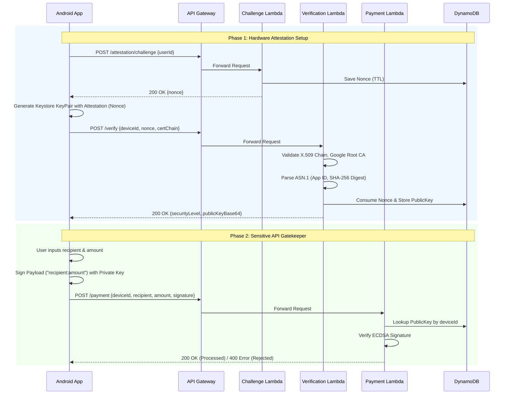

# Android Hardware Attestation POC

## Project Overview

This project is a Proof of Concept (POC) for implementing Android Hardware Attestation and using it to secure a sensitive API endpoint. The architecture guarantees that API requests are initiated from a legitimate, untampered device application using hardware-backed cryptography (TEE or StrongBox).

The project is divided into two distinct phases:

1. **Hardware Attestation Setup:** 
   The device requests a cryptographic challenge (nonce). It then generates a new hardware-backed Key Pair natively via Android Keystore, injecting the nonce into the attestation extension. The generated X.509 certificate chain is sent to the backend, which parses the ASN.1 extension to verify the package name, signature digest (App ID), and nonce. If valid, the device's public key is securely registered in a database.
2. **Sensitive API Gatekeeper (Payment):** 
   Once the public key is registered, the device can access sensitive endpoints (e.g., submitting a payment). The device signs the request payload using its hardware-backed private key. The backend retrieves the registered public key for that device, verifies the ECDSA signature, and accepts or rejects the transaction.

---

## End-to-End Flow



---

## API Contracts

### 1. Challenge API
Generates a cryptographic challenge (nonce) to prevent replay attacks during the attestation phase.

- **Endpoint:** `POST /attestation/challenge`
- **Request Body:**
  ```json
  {
    "userId": "string"
  }
  ```
- **Response (200 OK):**
  ```json
  {
    "nonce": "string (hex)"
  }
  ```

### 2. Verify API
Validates the Android hardware attestation certificate chain and registers the device's public key.

- **Endpoint:** `POST /verify`
- **Request Body:**
  ```json
  {
    "userId": "string",
    "deviceId": "string",
    "nonce": "string",
    "certificateChain": [
      "string (Base64 Encoded X.509 Certificate)",
      "string (Base64 Encoded Intermediate Cert)",
      "string (Base64 Encoded Google Root Cert)"
    ]
  }
  ```
- **Response (200 OK):**
  ```json
  {
    "securityLevel": "TEE | STRONGBOX",
    "publicKeyBase64": "string (Base64 encoded public key bytes)"
  }
  ```

### 3. Payment API
A gatekeeper API that processes a payment request only if the payload is correctly signed by an attested device's private key.

- **Endpoint:** `POST /payment`
- **Signed Payload Structure:** The raw bytes sent to the ECDSA signature algorithm is a UTF-8 string structured as `"${recipient}:${amount}"`.
- **Request Body:**
  ```json
  {
    "userId": "string",
    "deviceId": "string",
    "recipient": "string",
    "amount": 0.0,
    "signatureBase64": "string (Base64 encoded ECDSA signature)"
  }
  ```
- **Response (200 OK):**
  ```json
  {
    "status": "success",
    "message": "Payment processed"
  }
  ```
- **Response (400 Bad Request):**
  ```json
  {
    "status": "error",
    "message": "Signature verification failed"
  }
  ```
